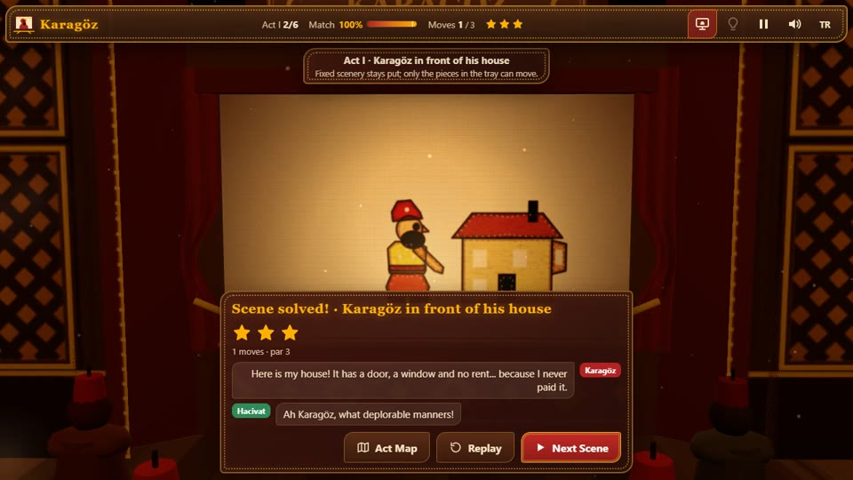
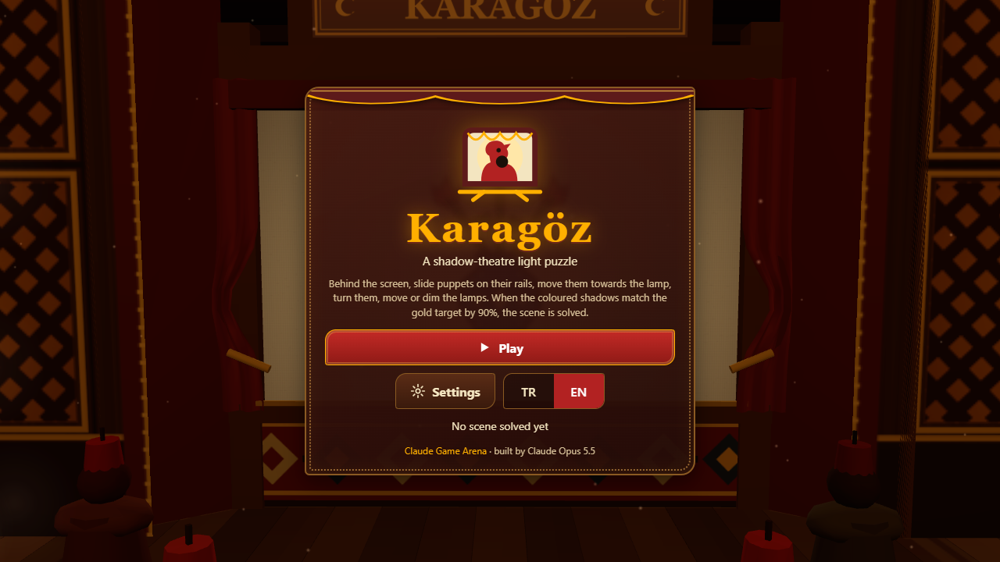
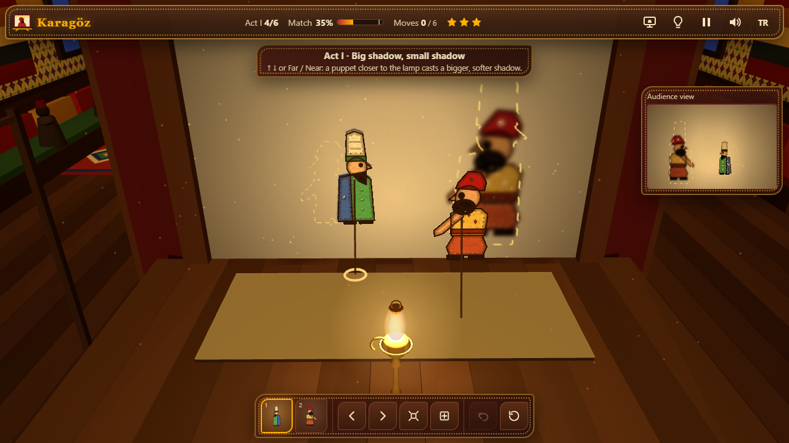
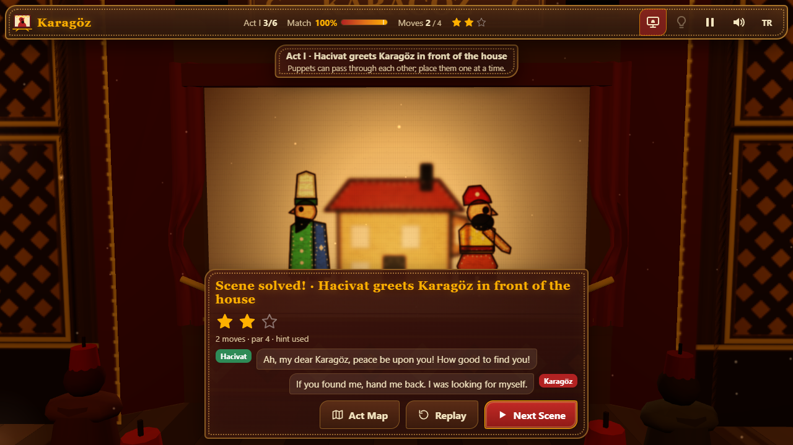
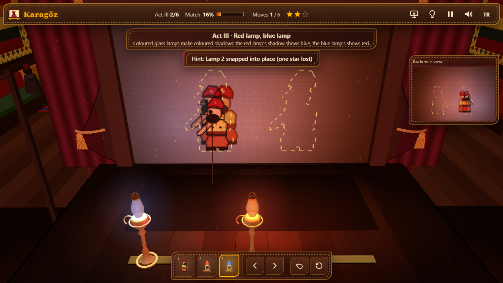
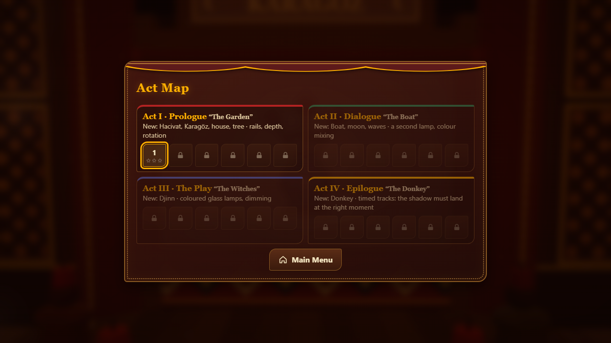
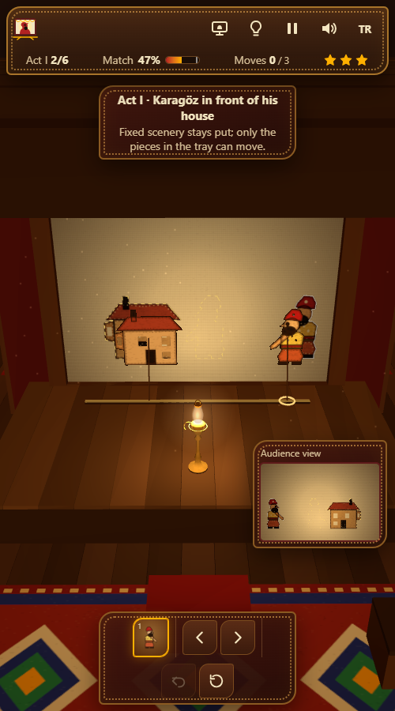
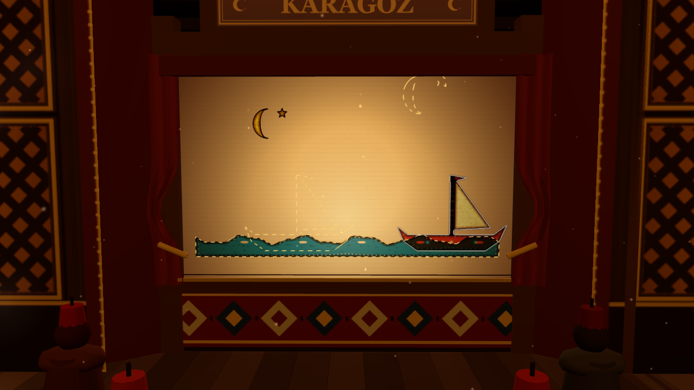
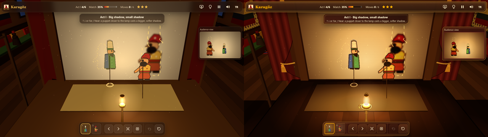

<p align="center">
  <a href="https://furkiozknn.github.io/karagoz/">
    
  </a>
</p>

<p align="center">
  <a href="https://furkiozknn.github.io/karagoz/"></a>
</p>

<p align="center">
  
  
  <a href="LICENSE"></a>
  
</p>

<!-- portals:start -->
<p align="center">
  Also on: <a href="https://furkiozknn.itch.io/karagoz"><strong>itch.io</strong></a>
</p>
<!-- portals:end -->

<p align="center">
  <strong>A 3D shadow-theatre light puzzle about Karagöz and Hacivat: in a dim Ottoman coffee house at night, slide and turn coloured leather puppets and move the oil lamps until their shadows on the cloth match the story picture.</strong>
</p>

<!-- gameplay gif -->

## Features

- **24 scenes across 4 acts:** Journey through Mukaddime (the garden), Muhavere (the boat), Fasıl (the witches and the djinn), and Bitiş (the donkey)—each act introducing new puppets, lamp mechanics, and timed sequences in Act IV.
- **Dynamic shadow optics & colour mixing:** Real point-light projection and flame penumbra make shadows grow soft and large near the lamp or small and sharp near the cloth; dual red and blue glass lamps mix colours dynamically through translucent leather.
- **90% match & 72-star mastery:** Slide and rotate puppets and adjust oil lamp intensity until the live shadow match reaches 90% against the target outline; earn up to 3 stars per scene across 24 scenes (72 stars total) with par-move and no-hint bonuses.
- **Automated bot verification:** An automated `?auto` bot plays through all 24 scenes from beginning to end using live pixel-matching logic, verifying that every reference puzzle can be solved with 0 JS errors.
- **Ultra-lean web performance:** A single self-contained `index.html` running Three.js r170 delivering 60 fps at 28–32 draw calls on Intel UHD 620 (1280×720), with procedural leather textures, shaders, and Web Audio makam Hicaz synthesis generated entirely in code.

## How to play

> [!TIP]
> **Goal:** The gold dashed outline on the screen is the target picture. Move the puppets and lamps until the live match % in the top bar reaches 90 %. Earn up to 3 stars per scene, 72 in all.

1. **Pick and position puppets:** Select a puppet or lamp from the tray. Backstage, drag a puppet along its rail; pull it towards or away from the screen to alter its shadow depth and size.
2. **Move and dim oil lamps:** Drag a brass kandil along its rail to reposition the light source; click it to dim or extinguish it to control shadow sharpness and colour overlap.
3. **Switch perspectives or rotate:** Work backstage on puppet rails or switch to the audience view (`V` or `Tab`) to drag shadows directly. Use `Q` / `E` or the mouse wheel to rotate puppets into alignment.

<details>
<summary><b>Rules and scoring</b></summary>

- **Tray buttons:** Move, rotate (`Q` / `E`), dim, or remove the selected piece. Faded pieces are off stage: tap one to put it up. Fixed scenery stays put.
- **Star scoring:** Earn 1 star for solving (reaching 90 % match), 1 star for par or fewer moves, and 1 star for using no hint (72 stars total across 24 scenes). A hint snaps one piece into place and costs a star.
- **Timed scenes (Act IV):** The donkey, the boat, and the djinn move along their tracks automatically. Shift their timing with Earlier / Later so their shadows match the target when the cue marker passes.
- **Celebratory show:** Matching the target to 90 % triggers a short TR / EN dialogue performance by Karagöz and Hacivat while the coffee-house audience laughs and applauds.
- **Solvable designs:** All 24 scenes are stored as code data tables and rendered from verified reference arrangements.

</details>

### Controls

| Action | Mouse / touch | Keyboard |
|---|---|---|
| Move selected piece | Drag puppet (backstage) or shadow (audience view) | `Left` / `Right` slide, `Up` further from screen, `Down` nearer |
| Move / dim a lamp | Drag along rail, click to dim or put out | `Left` / `Right` move, `Up` / `Down` brighten or dim |
| Rotate | Wheel, two-finger twist, tray buttons | `Q` / `E` |
| Select piece or lamp | Tray | `1`–`9` (an off-stage piece is put up) |
| Remove from stage | Tray button | `Del` / `Backspace` |
| Backstage / audience view | View button | `V` or `Tab` (`Shift+Tab` reaches buttons) |
| Undo / reset | Undo and reset buttons | `Z` / `R` |
| Hint (costs a star) | Hint button | `H` |
| Pause | Pause button | `P` / `Esc` |
| Music / effects / language | HUD buttons | `M` / `X` / `L` |

- **Persistence:** Settings are saved in `localStorage` under `arena.karagoz.settings`; progress (stars per scene and active scene) under `arena.karagoz.save`, and best star total under `arena.karagoz.best`.
- **Language & tier:** Language follows the browser (Turkish for `tr-*`, English otherwise); phones start on the Low tier.

<details>
<summary><b>URL flags for testing</b></summary>

| Flag | Effect |
|---|---|
| `?auto` | A bot plays all 24 scenes to the end, reading the same match % a player sees and making one move at a time |
| `?debug` | FPS, draw calls, triangles, GPU name and JS errors on screen; `window.karagozSim(seconds)` and `window.karagozDebug` |
| `?sim=N` | Fast-forward N seconds of simulation before the first frame |
| `?low` | Shadows off, pixel ratio 1, smaller screen texture, half the dust particles |
| `?scene=N` | Jump straight to scene N (1–24) |
| `?view=aud` | Start in the audience view |
| `?lang=en` / `?lang=tr` | Start language |
| `?nosave` | Do not write to `localStorage` |
| `?noassets` | Accepted for arena convention; the game ships no asset files anyway |

`window.karagoz` exposes the live state.

</details>

## Screenshots

<table>
  <tr>
    <td width="33%"><br><sub>Title screen</sub></td>
    <td width="33%"><br><sub>Backstage: big shadow, small shadow</sub></td>
    <td width="33%"><br><sub>Scene solved: Karagöz and Hacivat talk</sub></td>
  </tr>
  <tr>
    <td><br><sub>Act III: red lamp, blue lamp</sub></td>
    <td><br><sub>Act map</sub></td>
    <td><br><sub>On a phone</sub></td>
  </tr>
  <tr>
    <td colspan="3"><br><sub>The café, audience side</sub></td>
  </tr>
</table>

## Redesign & Performance

**Art direction:** Traditional Ottoman shadow theatre. Lamp amber `#FFB000`, screen linen `#F3E5C0`, leather dyes red `#B22222`, green `#2E8B57` and indigo `#283593`, curtain maroon `#5D1A1A`; translucent tooled leather in an oil-lit coffee house.

**Visual updates (rules, controls, bot, and saves are untouched):**
- **Café:** Lime-plaster walls with an İznik-style tile dado and a stencilled frieze, carved walnut proscenium with an ogee arch and lamp-lit lattice panels, kilims on the floor, swaying brass lanterns with amber glass, nargile pipes with rising smoke, audience in coloured robes, and a planked puppet table backstage.
- **Puppets and lamps:** Leather with grain, darker cut edges and punched dot rows both on 3D puppets and in shadows (display only: match is still scored from plain shapes); puppets glow like backlit hide and sway on their rods. Lamps are turned brass kandils with a bulb chimney and handle.
- **Stage:** Lamp-lit linen cloth (warm glow on each kandil, darker amber edges, weave, vignette); leather shadows get a render-only stained-glass overlay with grain, outlines, and punched dots; maroon drapes with gold tassels and carved ogee arch frame the screen backstage.
- **FX:** Slow oil-lamp breathing on top of flicker, flame wobble, and gold sparks along the screen on every solve.
- **UI:** Cut-leather panels with punched hole borders, maroon curtain valance over every menu, walnut top bar, dye-coloured act cards, 14 px minimum body text on phones, and compact landscape layout.

**Measured on an Intel UHD 620 (headless Chrome, 1280×720):**
- Static scenes: ~60 fps (draw calls: 18–22 &rarr; 28–32)
- Timed Act IV scenes: ~39 fps (cloth redrawn every 30 ms; `?low` delivers 60 fps)
- `?auto` bot plays all 24 scenes with 0 JS errors, with assets and with `?noassets`; `?lang=en` and `?lang=tr` show 0 errors.



## Running locally

Serve the folder over HTTP (ES modules do not load from `file://`):

```bash
python -m http.server 8000
```

Then open <http://localhost:8000/>.

## Made with Claude Code

Built by **Claude Opus 5.5** with Claude Code from one prompt: [prompts/karagoz.md](prompts/karagoz.md). Everything is generated in code; Three.js r170 is loaded from a CDN under its MIT licence.

<details>
<summary><b>Technical notes</b></summary>

- **Shadow simulation:** Each puppet is a set of 2D leather polygons with perforations, baked at startup into a transmission sprite. For each lamp, a canvas layer is filled with the lamp colour and every sprite is drawn on it with `multiply`, scaled by the point-light projection `s = D / (D - p)` around the lamp and blurred by the flame penumbra `r · p / (D - p)`. The lamp layers are added together into the cloth texture of the 3D screen.
- **Match algorithm:** The current and reference arrangements are drawn into an 80×52 offscreen canvas; the score is a weighted Jaccard index of per-pixel, per-channel darkness, times a brightness factor that catches wrongly dimmed lamps.
- **3D environment:** A flat-shaded, vertex-coloured coffee house merged into a few draw calls, instanced audience silhouettes, one shadow-casting directional light, lamp point lights backstage, and soft-sprite dust motes. The screen texture is redrawn only when something on it changes.
- **Procedural audio (Web Audio only):** A ney melody in makam Hicaz over a tef in an 8-beat usul, a drone, the nareke whistle, synthesised audience laughs, applause, cloth rustles, and lamp clinks.

</details>

### Claude Game Arena

Karagöz is part of the **Claude Game Arena** series, where each game is built by a Claude model from one prompt.

[Hisar](https://furkiozknn.github.io/kale-savunmasi/) · [Çay Ocağı](https://furkiozknn.github.io/cay-ocagi/) · [Çini Ustası](https://furkiozknn.github.io/cini-ustasi/) · [Martı](https://furkiozknn.github.io/marti/) · [Kervan](https://furkiozknn.github.io/kervan/) · [Dolmuş](https://furkiozknn.github.io/dolmus/) · [Peri Golf](https://furkiozknn.github.io/peri-golf/) · [Mehter](https://furkiozknn.github.io/mehter/) · [Boğaz Vapuru](https://furkiozknn.github.io/bogaz-vapuru/) · [Simit Fırını](https://furkiozknn.github.io/simit-firini/) · [Kırkpınar](https://furkiozknn.github.io/kirkpinar/) · [Lale Bahçesi](https://furkiozknn.github.io/lale-bahcesi/)

**Round 5:** [Kapadokya Balonu](https://furkiozknn.github.io/kapadokya-balonu/) · [Ebru](https://furkiozknn.github.io/ebru/) · [Kırkpınar](https://furkiozknn.github.io/kirkpinar/) · [Çarşı Kaçışı](https://furkiozknn.github.io/carsi-kacisi/)

**Round 6:** [Topkapı Gecesi](https://furkiozknn.github.io/topkapi-gecesi/) · [Hamsi](https://furkiozknn.github.io/hamsi/) · [Pamukkale](https://furkiozknn.github.io/pamukkale/) · [Mimar Sinan](https://furkiozknn.github.io/mimar-sinan/)

## License

MIT, see [LICENSE](LICENSE).

Like the game? You can support new rounds on [Buy Me a Coffee](https://buymeacoffee.com/furkiozkann). The game stays free.
