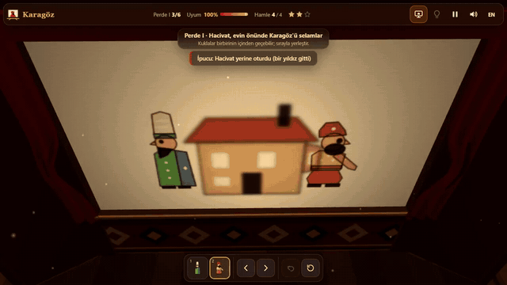
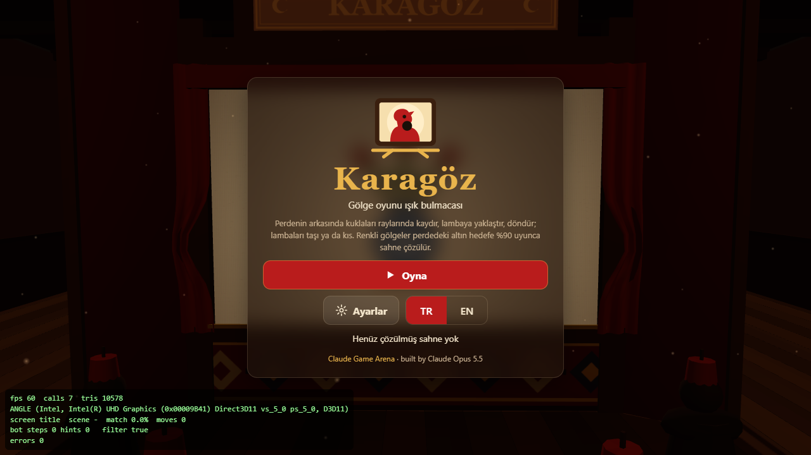
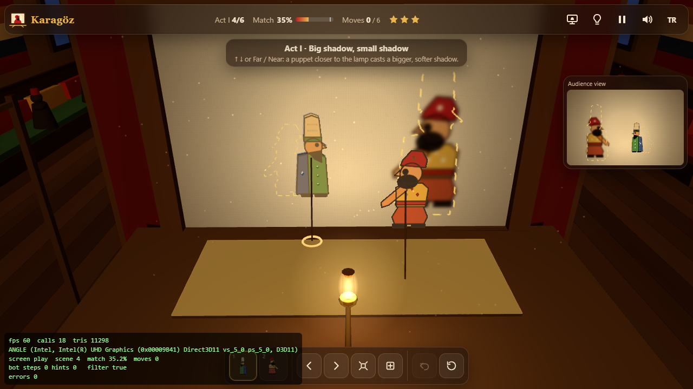
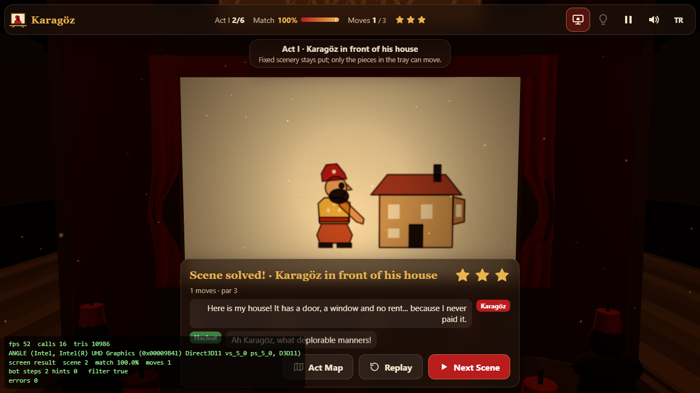
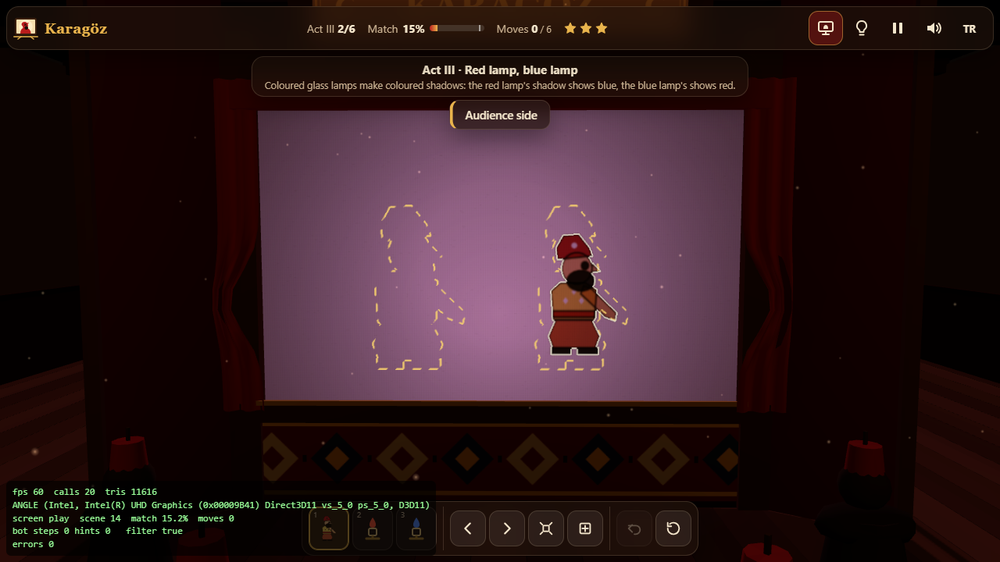
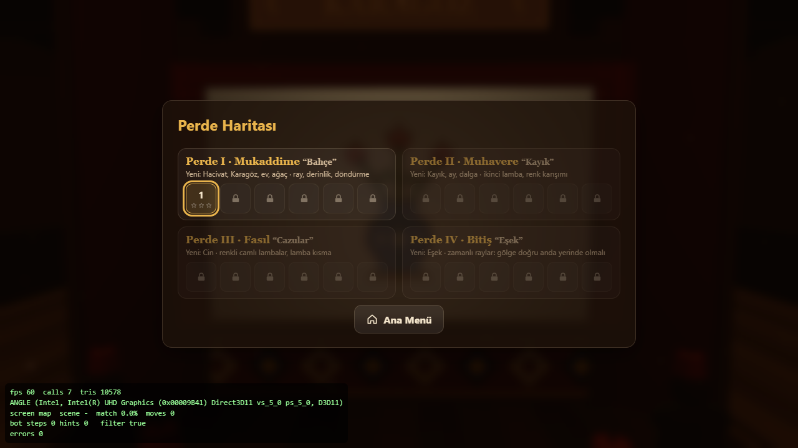
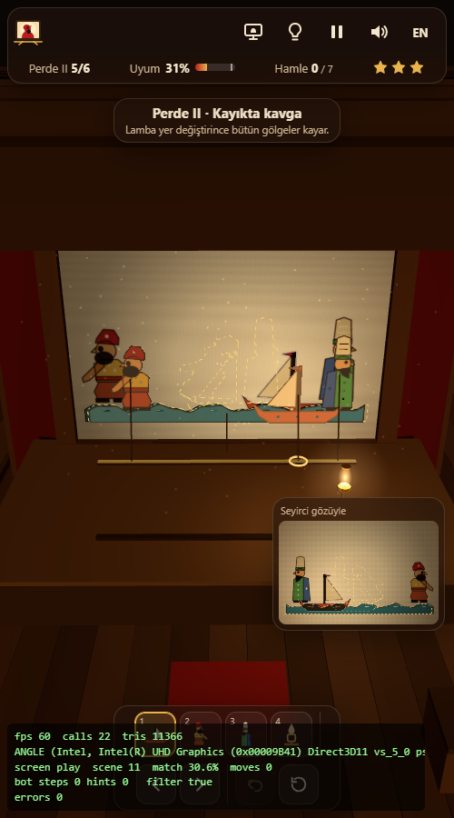

<p align="center">
  <a href="https://furkiozknn.github.io/karagoz/"></a>
</p>

<p align="center">
  <a href="https://furkiozknn.github.io/karagoz/"></a>
  
  
  <a href="LICENSE"></a>
  
</p>

<p align="center"><b>A 3D shadow-theatre light puzzle about Karagöz and Hacivat: in a dim Ottoman coffee house at night, slide and turn coloured leather puppets and move the oil lamps until their shadows on the cloth match the story picture.</b></p>

<p align="center">
  
</p>

<p align="center"><b>Play online: <a href="https://furkiozknn.github.io/karagoz/">https://furkiozknn.github.io/karagoz/</a></b> (desktop and phone, no install)</p>

## Highlights

- **Real shadow optics.** A puppet near the lamp casts a big, soft shadow; near the cloth a small, sharp one. Two lamps
  make two shadows, and the shadows are computed with a true point-light projection and flame penumbra.
- **Coloured light.** Translucent leather multiplies the light, so overlapping pieces mix their colours; with red and
  blue glass lamps, each lamp's shadow shows in the other lamp's colour.
- **Two views.** Work backstage, dragging puppets on their rails and moving or dimming lamps, or switch to the audience
  view and drag the shadows themselves; a small inset always shows what the audience sees.
- **24 scenes in 4 acts.** Mukaddime (the garden), Muhavere (the boat), Fasıl (the witches and the djinn) and Bitiş (the
  donkey); each act adds new puppets, lamp types and mechanics, and act IV adds timed scenes with moving pieces.
- **A show after every solve.** Match the target to 90 % and the puppets act out a short TR / EN dialogue while the
  audience laughs and claps.
- **Played by a bot.** The `?auto` bot plays all 24 scenes, reading the same match % a player sees and making one move
  at a time; every target is rendered from a reference arrangement, so every scene can be solved.
- **One file, made in code.** One `index.html` with Three.js r170 from a CDN; every mesh, texture and sound is
  generated in code.

## How to play

> [!TIP]
> **Goal:** the gold dashed outline on the screen is the target picture. Move the puppets and lamps until the live
> match % in the top bar reaches 90 %. Earn up to 3 stars per scene, 72 in all.

Pick a piece or a lamp from the tray. Backstage, drag a puppet along its rail; pulling it towards or away from the screen
changes its depth. Click a lamp to dim it or put it out, and drag it along its rail to move it. In the audience view, drag
a shadow to slide its puppet; dragging up or down changes the depth.

<details>
<summary><b>More rules</b></summary>

- The buttons next to the tray move, turn, dim or remove the selected piece. Faded pieces are off stage: tap one to put
  it up. Fixed scenery stays put.
- **Stars:** one for solving, one for par or fewer moves, one for using no hint. A hint snaps one piece into place and
  costs a star.
- **Timed scenes (act IV):** the donkey, the boat and the djinn move along their tracks by themselves. Shift their timing
  with Earlier / Later; their shadows must be on the target when the cue marker passes.
- The scenes are one data table in the code, and every target is rendered from a reference arrangement.

</details>

### Controls

| Action | Mouse / touch | Keyboard |
|---|---|---|
| Move the selected piece | drag the puppet (backstage) or its shadow (audience view) | `Left` / `Right` slide, `Up` further from the screen, `Down` nearer |
| Move / dim a lamp | drag it along its rail, click to dim or put out | `Left` / `Right` move, `Up` / `Down` brighten or dim |
| Rotate | wheel, two-finger twist, tray buttons | `Q` / `E` |
| Select a piece or lamp | tray | `1`-`9` (an off-stage piece is put up) |
| Take a piece off stage | tray button | `Del` / `Backspace` |
| Backstage / audience view | view button | `V` or `Tab` from the stage (`Shift+Tab` reaches the buttons) |
| Undo / reset | undo and reset buttons | `Z` / `R` |
| Hint (costs a star) | hint button | `H` |
| Pause | pause button | `P` / `Esc` |
| Music / effects / language | HUD buttons | `M` / `X` / `L` |

Settings are saved in `localStorage` under `arena.karagoz.settings`; progress (stars per scene and the scene in
progress) under `arena.karagoz.save`, the best star total under `arena.karagoz.best`. Turkish is the default language;
phones start on the Low tier.

<details>
<summary><b>URL flags for testing</b></summary>

| Flag | Effect |
|---|---|
| `?auto` | a bot plays all 24 scenes to the end, reading the same match % a player sees and making one move at a time |
| `?debug` | fps, draw calls, triangles, GPU name and JS errors on screen; `window.karagozSim(seconds)` and `window.karagozDebug` |
| `?sim=N` | fast-forward N seconds of simulation before the first frame |
| `?low` | shadows off, pixel ratio 1, smaller screen texture, half the dust particles |
| `?scene=N` | jump straight to scene N (1-24) |
| `?view=aud` | start in the audience view |
| `?lang=en` / `?lang=tr` | language |
| `?nosave` | do not write to `localStorage` |
| `?noassets` | accepted; the game ships no asset files, so it changes nothing |

The live state is on `window.karagoz`.

</details>

## Screenshots

<table>
  <tr>
    <td width="33%"><br><sub>Title screen</sub></td>
    <td width="33%"><br><sub>Backstage: big shadow, small shadow</sub></td>
    <td width="33%"><br><sub>Scene solved: Karagöz and Hacivat talk</sub></td>
  </tr>
  <tr>
    <td><br><sub>Act III: red lamp, blue lamp</sub></td>
    <td><br><sub>Act map</sub></td>
    <td><br><sub>On a phone</sub></td>
  </tr>
</table>

## Running locally

Serve the folder over HTTP (ES modules do not load from `file://`):

```
python -m http.server 8000
```

then open <http://localhost:8000/>.

## How it was made

Built by **Claude Opus 5.5** with Claude Code from one prompt: [prompts/karagoz.md](prompts/karagoz.md). Everything is
generated in code:

- **Shadows:** each puppet is a set of 2D leather polygons with perforations, baked at startup into a transmission
  sprite. For each lamp, a canvas layer is filled with the lamp colour and every sprite is drawn on it with `multiply`,
  scaled by the point-light projection `s = D / (D - p)` around the lamp and blurred by the flame penumbra
  `r · p / (D - p)`. The lamp layers are added together into the cloth texture of the 3D screen.
- **Match:** the current and the reference arrangement are drawn into an 80×52 offscreen canvas; the score is a weighted
  Jaccard index of per-pixel, per-channel darkness, times a brightness factor that catches wrongly dimmed lamps.
- **3D:** a flat-shaded, vertex-coloured coffee house merged into a few draw calls, instanced audience silhouettes, one
  shadow-casting directional light, lamp point lights backstage and soft-sprite dust motes. The screen texture is
  redrawn only when something on it changes.
- **Audio:** Web Audio only: a ney melody in makam Hicaz over a tef in an 8-beat usul, a drone, the nareke whistle,
  synthesised audience laughs, applause, cloth rustles and lamp clinks.

Karagöz is part of the **Claude Game Arena** series, where each game is built by a Claude model from one prompt. The
other games: [Hisar](https://furkiozknn.github.io/kale-savunmasi/) ·
[Çay Ocağı](https://furkiozknn.github.io/cay-ocagi/) · [Çini Ustası](https://furkiozknn.github.io/cini-ustasi/) ·
[Martı](https://furkiozknn.github.io/marti/) · [Kervan](https://furkiozknn.github.io/kervan/) ·
[Dolmuş](https://furkiozknn.github.io/dolmus/) · [Peri Golf](https://furkiozknn.github.io/peri-golf/) ·
[Mehter](https://furkiozknn.github.io/mehter/) · [Boğaz Vapuru](https://furkiozknn.github.io/bogaz-vapuru/) ·
[Simit Fırını](https://furkiozknn.github.io/simit-firini/) · [Lale Bahçesi](https://furkiozknn.github.io/lale-bahcesi/)

## Türkçe

**Karagöz**, gece bir Osmanlı kahvehanesinde geçen 3D gölge oyunu ışık bulmacası. Perdenin arkasında renkli deri
tasvirleri kaydır ve döndür, kandilleri taşı ya da kıs; gölgeler altın hedef çizgisine %90 uyunca Karagöz ile Hacivat
sahneyi oynar, seyirci güler ve alkışlar. 4 perdede 24 sahne var. Kurulum yok; masaüstünde ve telefonda tarayıcıda
oynanır. Claude Opus 5.5 tarafından Claude Code ile tek bir prompt'tan yapıldı.

**Oyna:** https://furkiozknn.github.io/karagoz/

## License

MIT, see [LICENSE](LICENSE).
